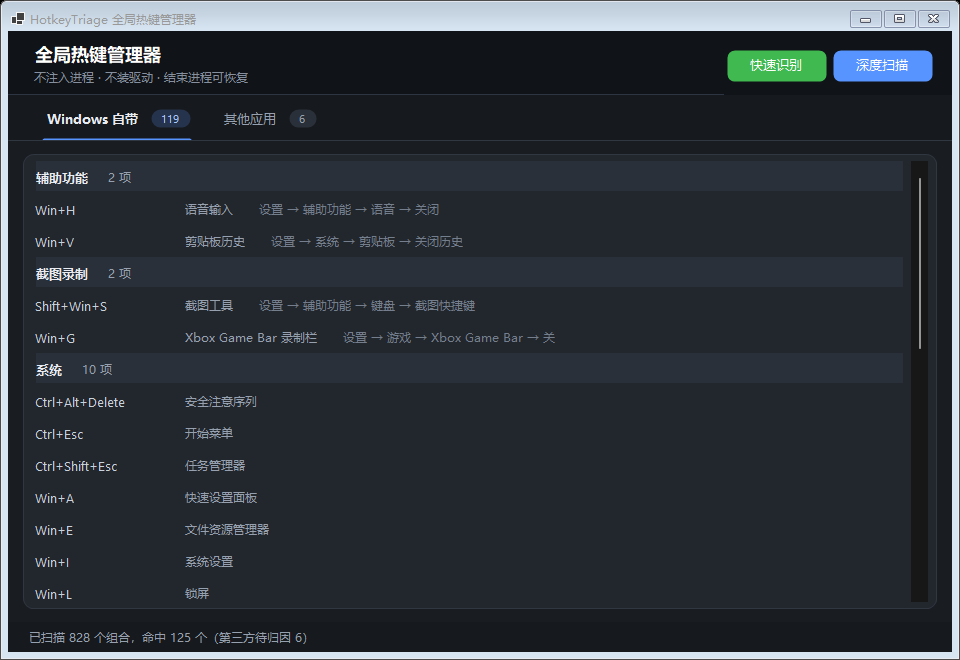
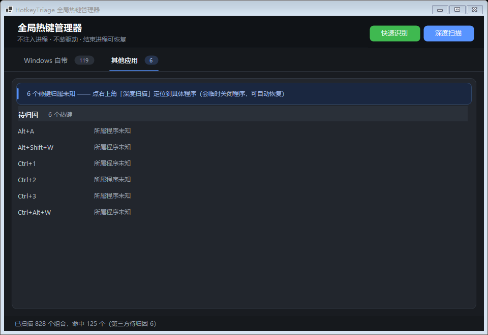

# HotkeyTriage · Windows 全局热键管理器

> **🤖 本项目由 AI 开发。** 需求、方向与验收由人决定，代码、测试与文档由 AI 生成并逐项实测验证。使用前请阅读文末 [AI 开发声明](#ai-开发声明)。

找出是**哪个程序**抢走了你的全局快捷键，并把它让出来。



---

## 为什么需要它

你按 `Alt+A` 想截图，结果是别的软件响应了；想改却不知道该关谁。这背后是 Windows 的一个设计缺口：

| 事实 | 后果 |
|---|---|
| 只有 `RegisterHotKey`，**没有** `EnumRegisteredHotKeys` | 没有任何 API 能反查"这个键是谁注册的" |
| 热键表 `gphkHashTable` 在内核 `win32kfull.sys` | 用户态读不到，必须装驱动 |
| `NtUserRegisterHotKey` 内部没有 `EtwTrace*` 调用 | ETW 也看不见热键注册 |

现有工具要么**够准但危险**（Hotkey Detective 需注入全进程，OpenArk 需签名驱动），要么**安全但无能**（只能告诉你"这个键被占了"）。而目标用户往往开着游戏反作弊——注入和驱动恰好是那条红线。

HotkeyTriage 的取舍是：**不装驱动、不读内核表，用"试注册 + 遍历复测"这种笨办法，把归属确定性地推出来。**

---

## 能做什么 / 做不到什么

先把边界说清楚，这决定了它是否适合你。

| ✅ 能做到 | ❌ 做不到 |
|---|---|
| 列出本机所有被占用的全局热键（实测本机 828 个组合 → 命中 125 个） | 手工配置不注册热键、只用键盘钩子吞键的程序（AutoHotkey 脚本、部分录屏/输入法） |
| 剥离系统热键与第三方热键，并给出**关闭路径** | 读取内核热键表（需要驱动，明确不做） |
| 定位第三方热键属于**哪个进程**（快速识别，不关程序） | 在自绘 UI 的程序里读出"这个键对应什么功能" |
| 对能读到菜单资源的程序显示**功能名**（如 `Ctrl+N → 新建`） | 保证 100% 覆盖：受保护进程、PPL 进程无法处理 |
| 结束占用进程，并记录启动信息以便恢复 | 保证恢复一定成功（商店应用存在句柄语义问题，见限制） |

---

## 界面

**「Windows 自带」页**：按"能不能关"排序——可关闭的功能排最前并展开，`Win+*` 这类上百条壳热键默认折叠，避免把有用的 5 条挤出首屏。


**「其他应用」页**：列出待归因的热键，归因后每个键右侧显示功能名或程序身份。



> 右侧列的信息用**亮度**表达可信度：亮的是从程序自身资源解析出的客观事实（功能名），暗的是辅助身份信息（公司名）。读不到功能名时不会编造，而是回落为程序身份。

---

## 快速开始

### 1. 获取程序

从 `dist/` 目录取两个文件，**必须放在同一目录**：

| 文件 | 作用 | 能否缺省 |
|---|---|---|
| `HotkeyTriage.exe` | 主程序（约 65 MB，自包含 .NET 运行时，免安装） | 必需 |
| `hook.dll` | 快速识别用的原生钩子（约 15 KB） | 只需深度扫描时可缺 |

### 2. 运行

双击 `HotkeyTriage.exe`。程序清单要求管理员权限，会弹出 UAC —— **必须同意，否则无法结束其他进程，也无法完整枚举**。

启动后自动执行快速扫描（约 1 秒），立即显示系统热键。

---

## 使用方式

### 快速扫描（自动）

启动即执行，只做"试注册"，**不打扰任何程序**。产出：哪些键被占用、其中哪些属于 Windows 自带。

### 快速识别（不关程序，推荐）

点顶部绿色「快速识别」。原理是注入钩子后模拟按键，观察谁收到了热键消息。

- **不会关闭任何程序**
- 但会**真的触发对方功能**（微信会弹截图框、录屏会开始录）
- 程序会在每个键触发后自动按 `ESC` 把弹窗收回，少数不响应 ESC 的程序可能残留
- 检测到反作弊进程运行时**直接拒绝执行**

### 深度扫描（会关程序）

点蓝色「深度扫描」。原理是逐个结束候选进程并复测热键是否释放。

- **会临时关闭勾选的程序**，完成后自动重启
- 有窗口的程序默认不勾选（可能有未保存内容）
- `explorer.exe` 与反作弊进程不会出现在列表中
- 结束前会把启动信息落盘，形成快照

### 结束与恢复

在归因结果中双击进程节点可结束该进程，启动信息会记录在 `%LOCALAPPDATA%` 下的快照文件中，便于恢复。

---

## 工作原理

三种手段，各有取舍，按"侵入性从低到高"依次使用：

| 手段 | 原理 | 是否关程序 | 确定性 |
|---|---|---|---|
| **试注册探测** | `RegisterHotKey` 返回 1409 即为被占用 | 否 | 只能判"被占"，不能判"谁占" |
| **快速识别** | 全局 `WH_GETMESSAGE` 钩子 + `SendInput` 模拟按键，捕获 `WM_HOTKEY` 的投递对象 | 否 | 高（但看不到钩子型占用人） |
| **深度扫描** | 结束进程 → 复测热键是否释放 → 恢复进程 | 是 | 确定性（遍历是穷举的） |

几个在开发中实测得出、写进代码的结论：

- **挂起进程不会释放热键。** 热键注册挂在注册线程上，进程被挂起后注册项仍在系统热键表里，按键被静默吞掉却没人响应。"临时禁用"这个中间态在 Windows 上不存在。
- **热键释放是即时的。** 结束进程后 0 ms 探测即 100% 返回空闲，无需等待（12 次重复实测）。
- **`F12` 是探测假阳性。** Windows 永久保留 F12 给调试器，`RegisterHotKey` 一律返回 1409，但**没有真实占用者**，也永远不会产生热键消息。
- **功能名来自程序自带的菜单资源。** 传统 Win32 程序把加速键写进菜单文本（`查找(&F)\tCtrl+F`），用 `LOAD_LIBRARY_AS_DATAFILE` 只读映射资源、不执行任何代码即可解析。自绘 UI（微信、Electron 应用）没有菜单资源，读不到。

---

## 技术栈

| 层 | 选型 | 选择理由 |
|---|---|---|
| 语言 / 运行时 | **C# / .NET 8**（`net8.0-windows`） | Win32 P/Invoke 生态最成熟，类型安全，启动快 |
| UI | **WinForms**（全自绘深色主题） | 自包含体积约为 WPF 的 1/3，冷启动更快；`TabControl`/`TreeView` 的默认外观无法满足设计，故自绘 `TabBar` / `CardPanel` / `InfoBanner`，`TreeView` 用 `OwnerDrawAll` |
| 原生钩子 | **C++ / MinGW-w64 g++** | 全局 `WH_GETMESSAGE` 钩子要求 DLL 被系统加载进目标进程，C# 无法实现 |
| 测试 | **xUnit** | .NET 生态事实标准，`[Theory]` 适合参数化断言 |
| 发布 | `PublishSingleFile` + `CompressionInSingleFile` + `win-x64` 自包含 | 目标机器无需预装 .NET，双击即用 |
| 权限 | `app.manifest` → `requireAdministrator` | 否则无法结束提权进程，会出现"为什么有些键查不到"的困惑 |
| 验证脚本 | **Python 3.13**（`probe/`，不进产品） | 快速验证 API 行为，仅用于开发期取数 |

### 为什么不是别的

- **不用 Python 打包**：`PyInstaller` 产物在"枚举进程 + 结束进程 + 模拟按键"这一组合下杀软误报率很高，且启动要解压数秒。
- **不用 WPF**：自包含体积约 130 MB，对一个"双击即查"的小工具过重。
- **不装内核驱动**：虽然读内核热键表最全，但驱动签名成本高、会被反作弊拦截，风险不可逆。遍历已经能拿到同样结果。

---

## 项目结构

```
.
├── src/
│   ├── HotkeyTriage.Core/          # 核心逻辑（无 UI 依赖）
│   │   ├── Probe/                  # 试注册探测、进程枚举、组合键格式化
│   │   ├── Discover/               # 快速扫描、深度扫描、快速识别、单键快查
│   │   ├── Attribute/              # 系统规则表、进程分类、安全闸门、功能名解析
│   │   ├── Act/                    # 进程结束/恢复、快照存储
│   │   └── Interop/                # 全部 Win32 P/Invoke 集中于此
│   ├── HotkeyTriage.App/           # WinForms 界面
│   ├── HotkeyTriage.Hook/          # C++ 原生钩子 DLL（hook.cpp）
│   ├── HotkeyTriage.Tests/         # xUnit 测试
│   └── HotkeyTriage.Diag/          # 诊断工具（见下文）
├── docs/
│   ├── 01-方案设计.md              # 设计阶段文档
│   ├── 02-设计文档.md
│   ├── 03-实现文档.md
│   ├── 实验记录.md                 # 实测数据
│   ├── screenshots/
│   └── archive/                    # 早期设计稿（已被实现超越）
├── probe/                          # 验证 API 行为的 Python 脚本
└── dist/                           # 发布产物（不进版本库）
```

> 📌 `docs/` 下的三份文档写于设计阶段，**部分内容已被实现超越**（例如早期方案曾假设"零权限"，实际已改为强制管理员）。**以 README 与源码为准。**

---

## 构建

### 前置

- [.NET 8 SDK](https://dotnet.microsoft.com/download/dotnet/8.0)
- MinGW-w64 `g++`（仅重新编译 `hook.dll` 时需要）

### 步骤

```bash
# 1. 编译原生钩子（仓库已附带预编译版本，可跳过）
cd src/HotkeyTriage.Hook
g++ -shared -o hook.dll hook.cpp -static -O2 -s -lkernel32 -luser32

# 2. 跑测试
dotnet test src/HotkeyTriage.Tests/HotkeyTriage.Tests.csproj

# 3. 发布单文件
dotnet publish src/HotkeyTriage.App/HotkeyTriage.App.csproj \
  -c Release -r win-x64 --self-contained true \
  -p:PublishSingleFile=true -p:EnableCompressionInSingleFile=true \
  -o dist
```

测试结果应为 **85 通过 / 2 跳过**。跳过的是两个需要真实可见窗口的用例——它们会产生用户可见的副作用（弹窗、窗口残留），改为由 `HotkeyTriage.Diag` 人工验证。

---

## 诊断工具 `HotkeyTriage.Diag`

排障与验证用，不参与发布：

```bash
# 端到端自证：自己注册热键 → 用快速识别去归因 → 看能否认出自己
HotkeyTriage.Diag

# 打印某个进程的"界面右侧那一列"原始数据（路径/公司/产品/版本/菜单功能数）
HotkeyTriage.Diag --appinfo weixin

# 读取某个 exe 的菜单资源，看能解析出多少"快捷键→功能名"
HotkeyTriage.Diag --menu-lab "C:\Windows\System32\notepad.exe"

# 验证"触发后自动 ESC 取消"：起子进程做靶子，按热键弹窗，看能否被收回
HotkeyTriage.Diag --dismiss-test

# 离屏渲染主窗口为 PNG（无交互桌面也能检查排版）
HotkeyTriage.Diag --shot out.png [tabIndex]
```

---

## 注意事项

### 安全

- **纯离线**：不联网、不上报任何数据、无遥测。
- **不装驱动**：任何情况下都不加载内核组件。
- **快速识别会注入 `hook.dll`**：这是它唯一"侵入"的地方，默认需要你确认才执行；检测到反作弊进程在运行会直接拒绝。
- **深度扫描会结束进程**：这是产品能力的必要代价，否则无法确定归属。程序会先弹确认框、默认不勾选有窗口的进程、并把启动信息落盘以便恢复。

### 杀软误报

"高权限 + 枚举全部进程 + 结束进程 + 模拟按键"是启发式引擎眼里的高危组合，被拦截并不意外。程序未做代码签名，首次运行可能触发 SmartScreen，可选择"更多信息 → 仍要运行"，或自行校验文件哈希。

### 已知限制

| 限制 | 原因 |
|---|---|
| 钩子型占用人查不到 | 它不注册热键、不产生 `WM_HOTKEY`，用户态没有任何可反查的接口。程序会在"无法归因"下列出正在运行的已知钩子型软件作为**可疑对象**（提示，非结论） |
| 微信等程序没有功能名 | 自绘 UI 没有菜单资源可读，只能显示程序身份 |
| 部分进程无法处理 | PPL 保护进程（反作弊、杀软）即使管理员也无法访问 |
| 商店应用恢复可能误判 | Win11 的 `notepad.exe` 是"应用执行别名"，由 Shell 拉起的是商店版进程，返回的句柄不代表真实窗口；`HasExited` 不能作为恢复成功的唯一判据 |
| `F12` 相关组合的判定 | Windows 永久保留 F12 给调试器，探测会显示"被占用"但实际无人占用，程序已将其归入"系统保留" |

---

## AI 开发声明

**这个项目的代码由 AI 生成。**

- **人类负责**：提出需求与场景、在关键岔路做决策（例如"要不要注入""能不能取消知识库""用不用深色主题"）、验收实际效果、指出问题。
- **AI 负责**：需求分析、方案设计、编码、单元测试、实验验证、文档撰写、界面渲染自查。
- **开发过程**：采用 TDD 与"先取证再修复"的排障纪律。多个结论来自实测而非推断，例如"挂起进程不释放热键""热键释放是即时的""F12 是探测假阳性""`INPUT` 结构在 64 位下必须是 40 字节"——这些都记录在 `docs/` 与代码注释中。

**这意味着什么：**

1. AI 生成的代码可能包含**看起来合理但实际错误**的逻辑。本项目在开发中确实出现过这类问题（例如 `DllImport` 缺少 `CharSet.Unicode` 导致进程路径被截断成一个字符，连带使进程恢复功能完全失效）。
2. 因此仓库保留了完整的测试、诊断工具与实验记录，以便复核结论。
3. **如果你要把本项目用于生产或分发，请自行做代码审查与安全评估。** 这是一个会请求管理员权限、结束其他进程、并向进程注入 DLL 的工具，风险需要使用者自己判断。

---

## 许可证

本仓库目前**未附带开源许可证**。在补充许可证之前，默认保留所有权利——如需开源分发，请自行添加（如 MIT / Apache-2.0）。
